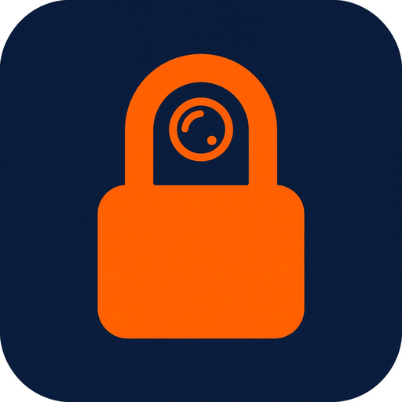

# Tuya SL-CE Videolock

<p align="center">
  
</p>

Integração custom do **Home Assistant** para a **Fechadura Inteligente SL-CE (Wi-Fi)** (Novadigital / **Tuya** Smart Life — categoria `videolock`).

Objetivo: **um único device** no HA com unlock Cloud (ticket), sensores de status e **stream de câmera** (OpenAPI allocate / Sharing).

| Capacidade | Status | Origem do padrão |
|------------|--------|------------------|
| Destrancar / trancar | ✅ Cloud ticket (`password-ticket` → `door-operate`) | [tuya-smart-lock](https://github.com/nicolasglg/tuya-smart-lock) (MIT) |
| PIN de destrave remoto (4 dígitos) | ✅ Definido no setup; hash PBKDF2; teclado nativo do HA | `LockEntity.code_format` |
| Bateria, online, campainha, last_* | ✅ Polling Cloud configurável (padrão **60 s**, min 1 s) | [ha-tuya-lock-monitor](https://github.com/crestall/ha-tuya-lock-monitor) (MIT) |
| Stream da câmera | ✅ Sharing + `stream/actions/allocate` (RTSP/HLS) + ffmpeg | Docs Tuya; comportamento estudado em [xtend_tuya](https://github.com/azerty9971/xtend_tuya) (GPL — **não copiado**) — ver [`docs/camera-todo.md`](docs/camera-todo.md) |

Versão atual: **0.7.1**.

Câmera: tenta primeiro o stream da integração oficial **Tuya** (sessão Smart Life, como o Xtend — sem trial). Fallback OpenAPI só se precisar; nesse caso o trial **IoT Video Live Stream** é grátis no portal (não dá para o addon “clicar” isso com Access ID/Secret). Detalhes: [`docs/camera-todo.md`](docs/camera-todo.md).

## Por que existe

A integração oficial Tuya **não** expõe `lock`. Três addons cobrem pedaços diferentes e o HA **não** permite juntar entidades de integrações distintas no mesmo device via UI. Esta integração unifica o fluxo Cloud (ticket unlock + DPs + câmera).

**LAN / tuya_local:** fora de escopo — neste videolock o unlock local não funciona de forma confiável.

## Pré-requisitos (Tuya IoT)

1. Conta em [platform.tuya.com](https://platform.tuya.com/) → projeto **Cloud** (método Smart Home)
2. Vincular a conta **Smart Life / Tuya** (QR) para o device aparecer
3. Autorizar serviços:
   - **IoT Core**
   - **Smart Lock Open Service** (trial ~6 meses — renovar quando expirar)
   - **IoT Video Live Stream** (para a câmera)
4. No app Smart Life: ativar **Remote Unlock / Unlock without password** na fechadura
5. Anotar **Access ID**, **Access Secret**, **Device ID** e a **região** do data center (`us` / `eu` / `cn` / `in`)

Device RuGiu de referência: `eba0b0f3d9b38977ed8b0a` — ver [`docs/device-sl-ce.md`](docs/device-sl-ce.md).

## Instalação

### Manual

1. Copiar `custom_components/slce_videolock` para `/config/custom_components/`
2. Garantir **ffmpeg** disponível no HA (a integração declara dependência)
3. Reiniciar o Home Assistant
4. **Settings → Devices & Services → Add Integration → Tuya SL-CE Videolock**
5. Informar Access ID / Secret / região, escolher a fechadura, definir a **senha de 4 dígitos** e o **intervalo de polling** (padrão 60 s)

### HACS

Repositório custom: `rubensflinco/tuya-slce-videolock` como Integration.

## Intervalo de polling

No setup (e depois em **Configurar** da integração) você escolhe de quantos em quantos segundos o HA consulta a Cloud Tuya.

- Padrão: **60 s**
- Faixa: **1–600 s**
- Valores muito baixos (ex.: 1 s) deixam campainha/last_* mais ágeis, mas cada poll faz várias chamadas — a Tuya pode rate-limitar

## Senha de destrave remoto

No setup da integração você define um **PIN numérico de 4 dígitos**. O Home Assistant passa a pedir esse código antes de destrancar (teclado nativo da entidade `lock`).

- A senha **não** fica em texto puro: só salt + hash PBKDF2-SHA256 no `config_entry`
- **Não há tela para alterar** a senha depois. Para trocar: remova a integração e adicione de novo
- Instalações antigas (sem PIN) precisam ser removidas e recriadas para ativar a proteção

## Entidades (mesmo device)

Identificador no registry: `(slce_videolock, <device_id>)`.

| Plataforma | Entidades |
|------------|-----------|
| `lock` | Fechadura (ticket unlock/lock) |
| `sensor` | Bateria, last fingerprint/password/card, app unlocks, temporary codes, last alarm, pedidos / last contact |
| `binary_sensor` | Online, Campainha, Alerta de coação |
| `camera` | Stream via allocate + snapshot ffmpeg |

## Testar câmera no HAOS

Ver checklist em [`docs/camera-todo.md`](docs/camera-todo.md).

## Desenvolvimento

Ver skills em `.cursor/skills/` e [`AGENTS.md`](AGENTS.md). Referências: [`docs/references.md`](docs/references.md).

```bash
python scripts/check_manifest.py
python scripts/build_release_zip.py
python -m unittest discover -s tests -v
```

Release (Marketplace/HACS): skill `ha-release` — bump + este README (também exibido no HA via `render_readme`) + tag + `gh release` com `slce_videolock.zip`.

## Atribuição / licenças

- Código desta integração: **MIT** (Rubens Flinco / RuGiu)
- Padrões de ticket unlock adaptados de [nicolasglg/tuya-smart-lock](https://github.com/nicolasglg/tuya-smart-lock) (MIT)
- Padrões de sensores / polling adaptados de [crestall/ha-tuya-lock-monitor](https://github.com/crestall/ha-tuya-lock-monitor) (MIT)
- Câmera: estudo de comportamento em [azerty9971/xtend_tuya](https://github.com/azerty9971/xtend_tuya) (GPL-3 — **sem cópia de código**) + API pública Tuya

## Licença

MIT — Rubens Flinco / RuGiu
